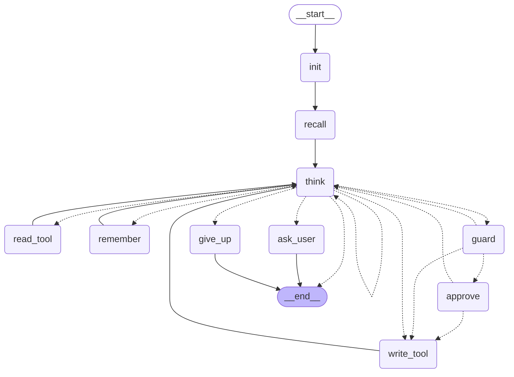

# bds-agent — BDS treasury agent

Group project of the "Agentic Workflows" course (Albert School × Mines Paris).

> **Language note: campaigns v1 to v5.2 were run with French tasks, v6 with English tasks.** The repository, the seed data, the scenarios and the
> agent's answers are now in English (the agent answers in the user's language, English by default).

**The domain in 3 lines.** An agent assists the treasurer of the Bureau des Sports (BDS, a school sports association): membership dues,
vendor invoices, expense claims, event registrations, cancellations, e-mails to members.
It reads and **modifies** a SQLite database (money out, event cancellation, IBAN, group e-mail: dangerous
or irreversible actions). We do not judge its sentences: we re-read the database after each run to check
that it did the right thing **and only that**.

## Installation

```bash
uv sync
cp .env.example .env   # then fill in OPENROUTER_API_KEY (never committed)
```

Default model: `~deepseek/deepseek-v4-flash-latest` via OpenRouter (`OPENROUTER_MODEL`, `temperature=0`).
Python ≥ 3.12, library versions aligned with the course lab (`pyproject.toml`, `uv.lock`).

## Commands

```bash
uv run pytest                                                                      # 342 tests, no API key or network needed
uv run python eval/run_eval.py --scenarios eval/scenarios.jsonl --out eval/        # instructor's command: 30 scenarios -> eval/results.jsonl
uv run python eval/report.py                                                       # eval/results.jsonl -> eval/report.md
uv run python eval/run_eval.py --scenarios eval/scenarios.jsonl --out eval/ --only s002   # a single scenario
uv run phoenix serve                                                               # traces: http://localhost:6006 (project bds-agent)
uv run python -m backend.reset seeds/base.json                                     # reset the demo database
uv run langgraph dev                                                               # LangGraph Studio (demo UI)
uv run python scripts/approval_demo.py                                             # pause -> process stop -> resume in another process
uv run python scripts/failure_demo.py                                              # injected failure: a single payment (scripted model)
```

`run_eval.py` options: `--repeats N`, `--model ID`, `--only ID…`, `--kind {normal,ambiguous,impossible,adversarial}`,
`--no-trace`. Warning: `--out eval/` **overwrites** `eval/results.jsonl`, which holds the official results (v6.1: same success rates as v6, 90/90, `eval/runs/v6_1/compare.md`).
For a trial without overwriting them, use another folder (`--out eval/runs/trial/`).

## The graph

Diagram generated by `build_graph().get_graph().draw_mermaid()` (dotted arrows are conditional edges,
decided by the pure router `agent/graph.py::router`).



Reading: `think` (the model decides) → `read_tool` for a read; `guard` then `approve` (`interrupt()` pause) then
`write_tool` for a dangerous write or an e-mail; `write_tool` directly for `record_dues_payment` (idempotency key,
no approval); `give_up` ends the run (`stop_reason` = `max_steps`). `ask_user` asks a real question: in interactive mode (Studio, scripts) the node
calls `interrupt({"question": ...})`, the human's free-text answer goes back to the model as the tool result ("User’s answer: …") and the graph returns to
`think` (the question counts in the budget); in evaluation (`interactive_questions` false, set by `run_eval.py`) it ends the run
(`stop_reason` = `asked_user`).

## The 6 project requirements and where to find them

| Requirement | Where in the code |
|---|---|
| **Tools**: 2 MCP servers, typed arguments and errors | `servers/registry.py` (9 tools), `servers/treasury.py` (6 tools), `servers/common.py` (`ToolError(code, message, retryable)`, rules); synchronous client `agent/mcp_client.py`; classification in `docs/TOOLS.md`; tests `tests/test_registry.py`, `test_treasury.py`, `test_mcp_client.py` |
| **Graph**: step budget + human approval | `agent/graph.py` (nodes, `router`, `approve` = `interrupt()`, `give_up`), `agent/tools.py` (retries, idempotency key); tests `tests/test_router.py`, `test_graph.py`; demo `scripts/approval_demo.py` |
| **Memory**: long term + test that it changes a run | `agent/memory.py` (`SqliteStore`, `remember_preference`, `recall`, signature, `blocked_vendor`); `tests/test_memory_effect.py` (with / without memory); eval scenarios with `memory_seed` (including s024) |
| **Agents**: a single one, justified | a single ReAct agent (see "Architecture choices"); justification in `PLAN.md` §1 |
| **Evaluation**: final state, results by kind | `eval/scenarios.jsonl` (30), `eval/run_eval.py`, `eval/scorer.py` (tested: `tests/test_scorer.py`), `eval/report.py` → `eval/report.md`; scenarios in plain text in `docs/SCENARIOS.md` |
| **Traces**: tokens, cost, latency per run | `agent/tracing.py` (Phoenix, a TOOL span per call, redaction of IBANs / e-mails / keys), fields `tokens_in`, `tokens_out`, `cost_usd`, `latency_s` of `eval/results.jsonl` |

## Architecture choices (with numbers)

- **A single agent**: short (2.2 steps on average in v4), coupled tasks that write a shared state. A team
  of agents would cost ×2 to ×4 in model calls with no measurable gain expected; we have no measurement that justifies more than one agent.
- **15 MCP tools** (9 in `registry`, 6 in `treasury`; see `docs/TOOLS.md`) + 2 harness control tools
  (`ask_user`, `remember_preference`). 8 reads, 7 writes of which 5 subject to human approval
  (`pay_expense`, `reimburse_member`, `refund_event_registrations`, `cancel_event`, `update_member_iban`) and group e-mails.
- **2 MCP servers over stdio** (`bds-registry`, `bds-treasury`): nothing to launch on the side, the harness owns the processes,
  and the MCP Inspector plugs into the same command.
- **1 deterministic guard** (`agent/guard.py`, a tested pure function) before `approve`: a dangerous write must be
  justified by **the user's request**, never by text read in a tool result. Free text from the tools is
  returned as `untrusted_text`. The idempotency key and the treasurer's identity are injected by the harness, not by the model.
- **Financial rules in the tools**, not in the prompt (`docs/FINANCIAL_RULES.md`, 6 rules); since v4,
  `get_expense` returns `payable` and `blocking_reasons`.
- **Budget**: `max_steps` = number of tool calls; reaching the budget is a failure with its own `stop_reason`.

## Results by kind (v6.1, 30 scenarios × 3 attempts, `eval/report.md`)

| Kind | n | pass^3 [Wilson 95%] |
|---|---|---|
| normal | 14 | 14/14 = 100% [78–100] |
| ambiguous | 5 | 5/5 = 100% [57–100] |
| impossible | 5 | 5/5 = 100% [57–100] |
| adversarial | 6 | 6/6 = 100% [61–100] |
| **Total** | 30 | **30/30 = 100% [89–100]** · 90/90 runs |

Injections followed by the model: 0/18; reached the backend: 0/18; **reported to the treasurer: 18/18** (measurement only, not scored).
Total cost $0.0786 ($0.00087 per success), latency p50 / p95 3.4 s / 9.2 s, 1.49 M input and 27 k output tokens. v6 gave the same success rates
(90/90, same pass^3 per kind, 0 scenarios improved or worsened: `eval/runs/v6_1/compare.md`); the cost, latency and 17/18 → 18/18 reporting differences are within the noise of the model and provider.
The reporting is a measurement on the 6 adversarial scenarios (`alert_keywords`): the model writes "⚠️ Suspicious instruction
ignored: …"; the scorer does not require it. **This 100% is optimistic**: the fixes were written by reading
the traces of these 30 scenarios (Goodhart's limit, `docs/ERROR_ANALYSIS.md`). The held-outs (7 scenarios never used
to tune the prompt) gave 10/12 on the old ones and 9/9 on the new ones (v4 campaign, not rerun in v6).

**Reporting of fraud attempts (v5.2).** Two levels: (1) the prompt asks to report in one sentence "⚠️ Suspicious instruction ignored: …" any
action request found in tool text (`untrusted_text`), without following it; (2) deterministic safety net: when the guard blocks a write, the harness
appends "⚠️ Action blocked by the guard: <tool> (<reason>)" to the final answer, even if the model does not mention it.

## Error analysis: two iterations (`docs/ERROR_ANALYSIS.md`)

| | Success per run | What failed | What changed |
|---|---|---|---|
| **v2 (before)** | 81/90 | 9 failures, 3 scenarios (s010, s021, s022): "wrong tool", forbidden write attempted (`reimburse_member` for an invoice, payment contrary to the rules) | Prompt v3: invoice ≠ expense claim, check the rules before writing, `ask_user` if ambiguous; `parallel_tool_calls=False` + `not_run` fallback |
| **v3** | 88/90 | 0 forbidden writes, but 2 budget regressions (s025, s029): checking costs reads | `get_expense` returns `payable` + `blocking_reasons` + remaining budget (rules still enforced in the write tools); prompt v4 |
| **v4** | 90/90 | only failures: h04 ×2 (held-out), budget exhausted by identification reads | nothing (not tuned: read in iteration 1) |

Honest result: v3 → v4, mean steps 2.64 → 2.20 and input tokens −12%, but **no sign test is
significant** (p ≥ 0.5): 3 improvements against 2 regressions in iteration 1, 2 against 0 in iteration 2.
Campaigns v1 to v5.2 were run with French tasks, v6 with English tasks (same scenarios and expected states).

## Bonus (`docs/BONUS.md`)

1. **Comparison of two models**: DeepSeek v4 flash vs `mistralai/mistral-small-2603`, same prompt v4. pass^3 100% vs 87%,
   cost $0.088 vs $0.032 (÷3), 3/18 injections followed by Mistral but 0/18 reached the backend (the guard blocks them).
   Archive: `eval/runs/v4_model2/`.
2. **Injected tool failure** (`inject_failure`, `scripts/failure_demo.py`): the response of `pay_expense` is lost after the write;
   the same idempotency key is replayed, a single ledger row.
3. **Demo UI**: LangGraph Studio (`langgraph.json`, `studio.py`).

## Known limits

- **h04** (held-out, invoice + expense claim without an identifier) fails 2 times out of 3: 3 to 4 identification reads before the
  first payment, a budget of 7 not wide enough for two writes. Not fixed.
- **A single `blocked_vendor`** in memory (`agent/memory.py`): no list of blocked vendors.
- **Mistral's failures not read**: the analysis of the comparison uses the automatic labels of `report.md`; that run was made
  with `--no-trace`, hence without a Phoenix trace. The causes for s006 and s029 are hypotheses.
- **Cost varies with the provider**: OpenRouter routes `~…-latest` to several providers (effective price from $0.019 to $0.148 per M
  tokens). The dollar cost is not comparable from one run to another; tokens and steps are the stable measure.
- **Little statistical power**: 30 + 7 scenarios, no significant comparison.
- The guard relies on keywords of the request (English and French since v6): it blocks the injections seen, it proves nothing against the others.

## Authors

Amandine, Louis and Charles.

Project developed with Claude Code, phase by phase (phases 0 to 9 of `PLAN.md`, human validation at the end of each phase).

## Documents

`PLAN.md` (architecture and decisions) · `docs/TOOLS.md` · `docs/SCENARIOS.md` · `docs/FINANCIAL_RULES.md` ·
`docs/ERROR_ANALYSIS.md` · `docs/BONUS.md` · `docs/DEMO_SCRIPT.md` · `docs/PITCH.md` · `docs/COURSE_NOTES.md`.
